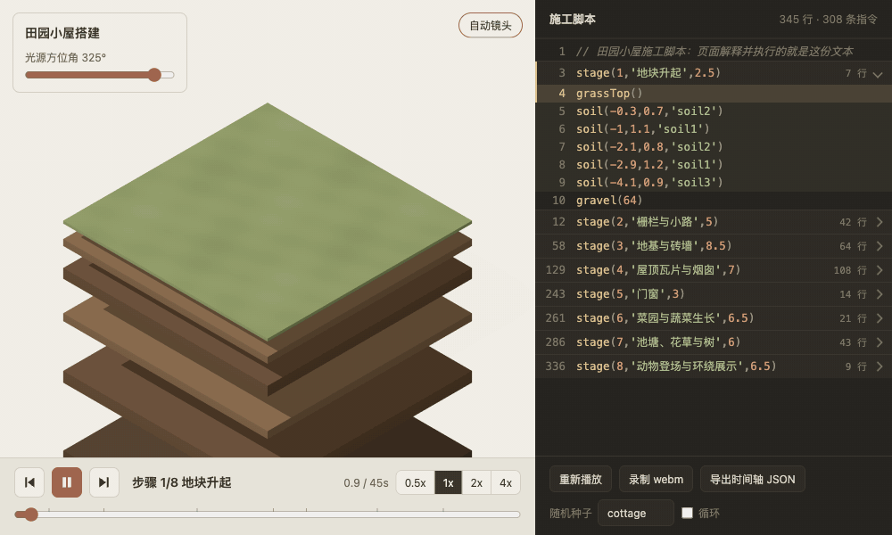
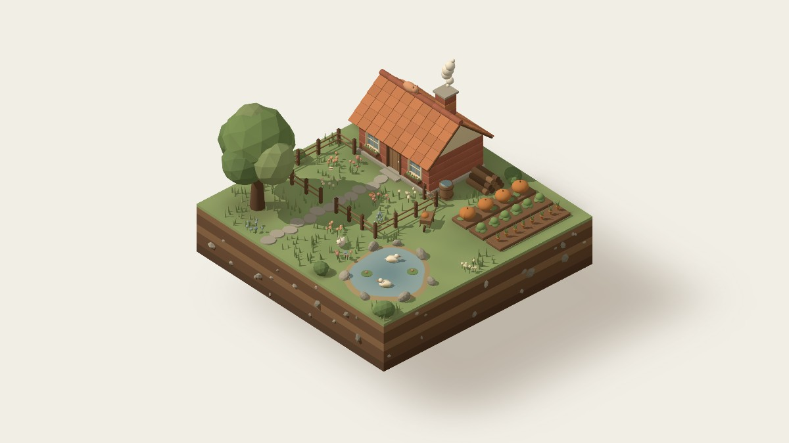

<p align="center">
  <a href="https://3d.dingxiaopi.com/cottage-build/"></a>
</p>

<h1 align="center">3D Gallery</h1>

<p align="center">3D web pages made with AI. Every piece runs in your browser, with its full prompt and code in the open.</p>

<p align="center">
  <a href="https://3d.dingxiaopi.com"><strong>Live gallery</strong></a> ·
  <a href="README.md">简体中文</a>
</p>

> The site and prompts are currently in Chinese.

## Works

<table>
  <tr>
    <td width="46%"><a href="https://3d.dingxiaopi.com/cottage-build/"></a></td>
    <td>
      <strong><a href="https://3d.dingxiaopi.com/cottage-build/">Cottage Build</a></strong><br><br>
      A miniature cottage rises from an empty plot, piece by piece. Scrub through the timeline, or click any line of the build script on the right to jump to the moment it finishes. That script is the code actually being run.<br><br>
      Three.js · single HTML file ·
      <a href="works/cottage-build/prompt.md">prompt</a> (by <a href="https://x.com/cfenghub/status/2116727428282569071">CF长风</a>) ·
      <a href="works/cottage-build/index.html">source</a>
    </td>
  </tr>
</table>

## What you get with each piece

- **Live demo**: runs in the browser, nothing to install.
- **The original prompt**: one click to copy, with its source credited.
- **Full source**: one HTML file you can download and double-click to open.
- **What changed afterwards**: an honest list of edits made beyond the prompt, because the result rarely comes from a single generation.

## Run locally

Requires Node.js and Python 3. No other dependencies.

```bash
git clone https://github.com/dingxiaopi/3d-pages.git
cd 3d-pages
npm run dev    # then open http://127.0.0.1:4323
```

To view a single piece, double-click `works/<name>/index.html` (an internet connection is needed to load three.js).

## How it works

Each piece is a folder in `works/`. A script generates the site from those folders, and pushing to `main` publishes it to GitHub Pages through GitHub Actions.

```text
works/<name>/
  index.html   the piece itself
  prompt.md    the original prompt
  meta.json    title, summary, prompt source, later changes
  cover.jpg    cover image
scripts/build.mjs  reads works/ and builds the site into dist/
```

## Contributing

Found a problem? Open an [issue](https://github.com/dingxiaopi/3d-pages/issues). To contribute a new piece, see [CONTRIBUTING.md](CONTRIBUTING.md) (in Chinese).

## Credits

- The cottage prompt is by [CF长风 (@cfenghub)](https://x.com/cfenghub/status/2116727428282569071), included with the author's permission.
- 3D rendering by [Three.js](https://threejs.org/).

## License

- Code, including each piece's `index.html`, is under the [MIT](LICENSE) license.
- **Prompts are not covered by MIT.** Rights to `works/*/prompt.md` belong to the author named in `meta.json`. Please check the original post and contact the author before reposting or adapting them.
