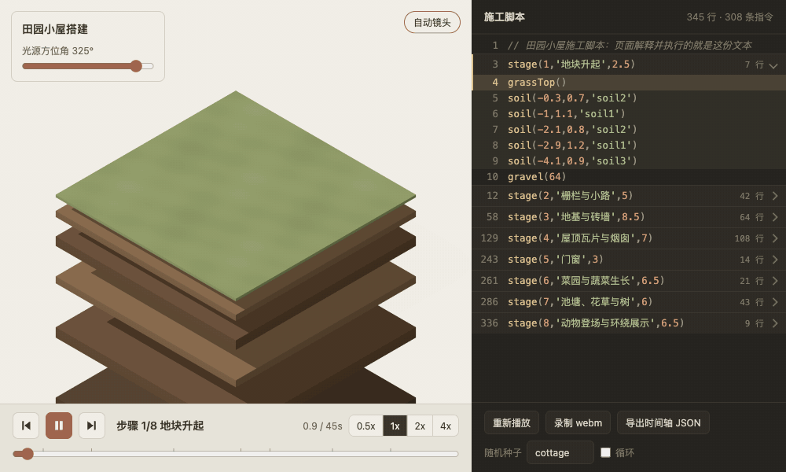
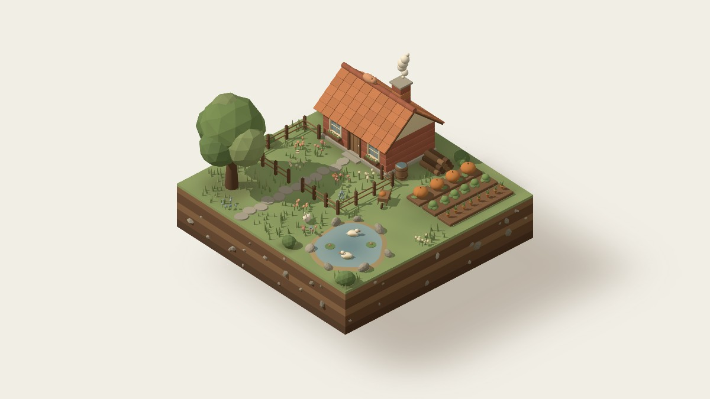

<p align="center">
  <a href="https://3d.dingxiaopi.com/cottage-build/"></a>
</p>

<h1 align="center">3D 作品集</h1>

<p align="center">用 AI 做的 3D 网页。每个作品都能在线玩，提示词和代码全部公开。</p>

<p align="center">
  <a href="https://3d.dingxiaopi.com"><strong>在线体验</strong></a> ·
  <a href="README.en.md">English</a>
</p>

## 作品

<table>
  <tr>
    <td width="46%"><a href="https://3d.dingxiaopi.com/cottage-build/"></a></td>
    <td>
      <strong><a href="https://3d.dingxiaopi.com/cottage-build/">田园小屋搭建</a></strong><br><br>
      一座微缩小屋从地块升起到完工的全过程。可以拖动回放；右侧的施工脚本就是实际执行的代码，点击任意一行，场景跳到这一行完成的时刻。<br><br>
      Three.js · 单文件 HTML ·
      <a href="works/cottage-build/prompt.md">提示词</a>（<a href="https://x.com/cfenghub/status/2116727428282569071">CF长风</a>）·
      <a href="works/cottage-build/index.html">源码</a>
    </td>
  </tr>
</table>

## 每个作品都有什么

- **在线效果**：打开网页就能玩，不用安装。
- **提示词原文**：可以一键复制，并注明来源。
- **完整代码**：单个 HTML 文件，下载后双击就能打开。
- **后续调整**：如实列出提示词之外改过什么，因为成品通常不是一次生成的。

## 本地运行

需要 Node.js 和 Python 3，没有其他依赖。

```bash
git clone https://github.com/dingxiaopi/3d-pages.git
cd 3d-pages
npm run dev    # 打开 http://127.0.0.1:4323
```

只想看某个作品的话，直接双击 `works/<作品名>/index.html` 即可（需要联网加载 three.js）。

## 工作原理

每个作品是 `works/` 下的一个目录，网站由脚本自动生成，推送到 `main` 后通过 GitHub Actions 发布到 GitHub Pages。

```text
works/<作品名>/
  index.html   作品本身
  prompt.md    提示词原文
  meta.json    标题、简介、提示词来源、后续调整
  cover.jpg    封面
scripts/build.mjs  读取 works/，生成网站到 dist/
```

## 参与贡献

发现问题可以提 [Issue](https://github.com/dingxiaopi/3d-pages/issues)，贡献新作品请看 [CONTRIBUTING.md](CONTRIBUTING.md)。

## 致谢

- 田园小屋的提示词来自 [CF长风（@cfenghub）](https://x.com/cfenghub/status/2116727428282569071)，经作者同意收录。
- 3D 渲染使用 [Three.js](https://threejs.org/)。

## 授权

- 代码（包括作品的 `index.html`）使用 [MIT](LICENSE) 协议。
- **提示词不在 MIT 范围内。** `works/*/prompt.md` 的权利归 `meta.json` 中注明的作者所有，转载或改编前请查看原文并联系作者。
